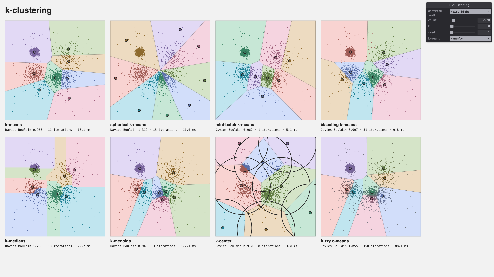

# k-clustering

[](https://www.npmjs.com/package/k-clustering)
[](https://www.npmjs.com/package/k-clustering)
[](https://bundlephobia.com/package/k-clustering)
[](https://github.com/dmnsgn/k-clustering/blob/main/package.json)
[](https://github.com/microsoft/TypeScript)
[](https://conventionalcommits.org)
[](https://github.com/prettier/prettier)
[](https://github.com/eslint/eslint)
[](https://github.com/dmnsgn/k-clustering/blob/main/LICENSE.md)

Center-based clustering of flat point arrays: k-means (Lloyd, Elkan, Hamerly, spherical, mini-batch, bisecting), k-medians, k-medoids (FasterPAM, PAM, Alternate), k-center and fuzzy c-means, with seeding and validation metrics.

[](https://paypal.me/dmnsgn)
[](https://commerce.coinbase.com/checkout/56cbdf28-e323-48d8-9c98-7019e72c97f3)
[](https://twitter.com/dmnsgn)
[](https://bsky.app/profile/dmnsgn.me)

[](https://dmnsgn.github.io/k-clustering/)

## Installation

```bash
npm install k-clustering
```

## Features

| Class             | Objective                            | Centers        | Iteration        | Best when                                     |
| ----------------- | ------------------------------------ | -------------- | ---------------- | --------------------------------------------- |
| `KMeans`          | Sum of squared Euclidean distances   | Means          | O(k n), or fewer | Compact clusters, color quantization, Voronoi |
| `MiniBatchKMeans` | Sum of squared Euclidean distances   | Means          | O(k b) per batch | Large inputs, approximate clusters            |
| `BisectingKMeans` | Sum of squared Euclidean distances   | Means          | O(n) per split   | Many clusters, hierarchical splits            |
| `KMedians`        | Sum of Manhattan distances           | Medians        | O(k n + n log n) | Outliers                                      |
| `KMedoids`        | Sum of distances, any dissimilarity  | Input points   | O(n²)            | Custom distances, actual points as centers    |
| `KCenter`         | Largest distance                     | Input points   | O(k n) in total  | Coverage, sampling, spreading points apart    |
| `FuzzyCMeans`     | Membership weighted squared distance | Weighted means | O(k n)           | Overlapping clusters, soft boundaries         |

`KMeans` options:

- `algorithm`: the same clusters at different speeds. `"hamerly"` (default) is fastest in low dimension, `"elkan"` in high dimension with many clusters: both use the triangle inequality to skip distance computations. `"lloyd"` uses no extra memory and is required by `index`.
- `spherical`: cluster directions by cosine distance.
- `index`: with `"lloyd"`, a nearest neighbour structure rebuilt over the centroids, such as a [spatial-partition](https://github.com/dmnsgn/spatial-partition) `KdTree`, for hundreds of clusters.

Initializations (`init` namespace), passed as the `init` option: `kMeansPlusPlus` D² sampling with greedy local trials (default), `randomPoints` (Forgy), `farthestFirst` traversal (maximin) and `build` (PAM BUILD, default of k-medoids). Any function returning `k` point indices works, eg. `(points, k, options) => kMeansPlusPlus(points, k, { ...options, localTrials: 1 })`.

Metrics (`metrics` namespace): inertia, silhouette, Davies–Bouldin and Calinski–Harabasz.

Helpers (`utils` namespace): the building blocks shared by the clusterings, such as `normalize` and `nearestCentroid`.

All structures are allocation-free once sized: buffers are reused across fits.

## Usage

```js
import { KMeans, KMedoids, metrics, distance } from "k-clustering";

// 4 colors, stored flat: r, g, b, r, g, b...
// prettier-ignore
const points = new Float32Array([
  0.9, 0.1, 0.1,
  1, 0.2, 0.1,
  0.1, 0.2, 0.9,
  0.2, 0.2, 1,
]);

// Find 2 clusters. Call fit again whenever the points change.
const kMeans = new KMeans({
  dimension: 3, // Default. 2 for x, y, x, y...
  k: 2,
  random: Math.random, // Default. A seeded generator gives reproducible results.
}).fit(points);
kMeans.labels; // [0, 0, 1, 1]: cluster of each point, in any order
kMeans.centroids; // [0.95, 0.15, 0.1, 0.15, 0.2, 0.95]: flat too
kMeans.predict([0.8, 0, 0.2]); // 0: cluster of the nearest centroid to a new point

// Refit with weighted points, starting from given centroids
kMeans.fit(points, { weights: [1, 1, 4, 1], centroids: [1, 0, 0, 0, 0, 1] });
kMeans.centroids; // [0.95, 0.15, 0.1, 0.12, 0.2, 0.92]

// How well the clusters are separated, up to 1: compare across k to pick one
metrics.silhouette(points, kMeans.labels); // 0.879

// Centers are input points, with any distance
const kMedoids = new KMedoids({ k: 2, distance: distance.manhattan });
kMedoids.fit(points).medoids; // [0, 2]: point indices
```

**Use cases**

`KMeans`

- Dominant colors and color quantization
- Centroidal Voronoi tessellations and stippling (Lloyd relaxation, weighted by image darkness)
- Grouping markers, particles or vertices
- Vector quantization of embeddings (`spherical`)

`MiniBatchKMeans`

- Palettes of large images without downscaling
- Clustering millions of points

`BisectingKMeans`

- Hierarchical palettes and levels of detail
- Many clusters with a stable split order

`KMedians`

- Data with outliers, such as noisy sensor readings
- Grid and city-block distances

`KMedoids`

- Clusters of strings, graphs or any custom dissimilarity: fit point indices in 1D with a precomputed `dissimilarities` matrix
- Picking representative samples: centers are real points

`KCenter`

- Facility placement and coverage
- Farthest point sampling of meshes and point clouds
- Spreading out a few distinct colors

`FuzzyCMeans`

- Soft segmentation and gradients between clusters
- Points shared by several groups

## API

<!-- api-start -->

Auto-generated API content.

<!-- api-end -->

## License

MIT. See [license file](https://github.com/dmnsgn/k-clustering/blob/main/LICENSE.md).
